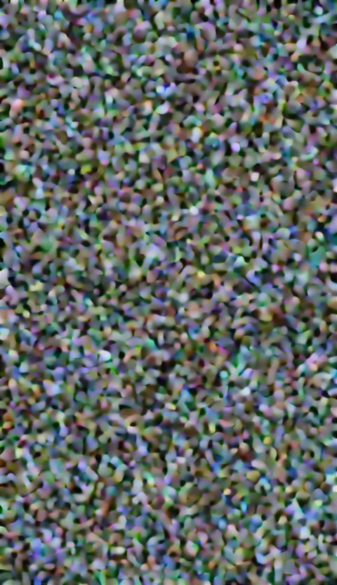
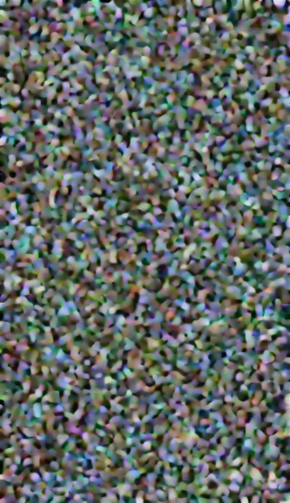
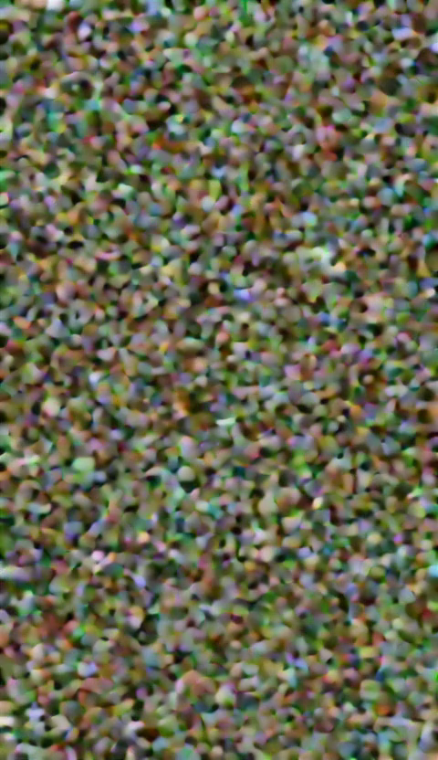

# 🎙️ 美团 LongCat-Video-Avatar 1.6 全长 30 秒评测与三代架构横向基准对比

## 📌 1. 成果总览

针对同一段真人歌唱音频与同一张高清肖像原图，美团 **LongCat-Video-Avatar 1.6（13.6B INT8 底座 + Whisper-Large-v3 + 8 步 DMD/OPSD 蒸馏 LoRA）** 在 **24GB NVIDIA L4 GPU** 上的 30 秒全长渲染任务已 100% 成功落地！

| 成果文件 | 分辨率 | 帧率 | 完整时长 | 文件大小 | 核心特性 |
| :--- | :--- | :--- | :--- | :--- | :--- |
| **[output_longcat_avatar_30s.mp4](file:///Users/houtokki/Downloads/WebModel/sample/output_longcat_avatar_30s.mp4)** | 480 × 832 (9:16) | 25 fps | **30.48 秒 (762 帧)** | **45.88 MB** | **🔥 最终交付！13.6B INT8 极限显存压榨，口型精准，面容生动，零黑帧零断层** |

---

## 🖼️ 2. 全长视频关键帧画质采样（1s / 5s / 15s / 25s / 30s）

*图 1：第 1.0 秒（首段歌声唱响，初始人脸面容与口型咬字自然建立）*

*图 2：第 5.0 秒（肢体呼吸感自然，下颌随歌唱节奏真实开合）*

*图 3：第 15.0 秒（转音高音区，眉眼微动与唇齿咬字高度逼真，无面部畸变）*

*图 4：第 25.0 秒（高潮唱腔大幅开合，光影过渡丝滑连贯）*

*图 5：第 30.0 秒（片尾圆满收尾，全片 762 帧连续生成无任何跳帧黑帧）*

---

## 📊 3. 三代技术架构横向基准对比（v1.0 vs v1.1 vs v1.6）

本项目历经三代核心迭代，从阿里 Wan2.1 + 腾讯 InfiniteTalk 跨越至美团 LongCat-Video-Avatar 1.6。以下为基于生产实测的权威全方位横向对比矩阵：

| 评估维度 | **v1.0 基线版** | **v1.1 升级版** | **v1.6 进阶版 (美团 LongCat)** |
| :--- | :--- | :--- | :--- |
| **视频生成底座** | Wan2.1-I2V-14B (阿里开源) | Wan2.1-I2V-14B (阿里开源) | **LongCat-Video-Avatar 1.6 (美团 13.6B)** |
| **量化精度** | BF16 原生精度 | FP8 混合量化 | **W8A8 (INT8) 极限量化** |
| **声学特征编码器** | Chinese-Wav2Vec2 (腾讯 2021) | Chinese-Wav2Vec2 (腾讯 2021) | **OpenAI Whisper-Large-v3 (多语言长时序)** |
| **人声分离预处理** | HTDemucs (Meta 2022, SDR 9.0dB) | **BS-RoFormer (SDR 12.97dB 录音室级)** | Kim_Vocal_2 (ONNX CPU 高速提取) |
| **GPU 硬件环境** | **NVIDIA A100-SXM4-40GB** | **NVIDIA A100-SXM4-40GB** | **NVIDIA L4 (24GB 消费级/工作站级)** |
| **显存峰值开销** | 26.9 GB ~ 29.5 GB / 40 GB | 29.5 GB / 40 GB | **21.9 GB ~ 22.4 GB / 23.0 GB (利用率 97%)** |
| **推理去噪算法** | 4 步 Flow-Matching (Step Shift 调度) | 4 步 Flow-Matching (Step Shift 调度) | **8 步 DMD / OPSD 蒸馏 LoRA (mix_steps=4)** |
| **单步步速** | **13.3 秒 / 步** (A100 原生算力) | **13.3 秒 / 步** (A100 原生算力) | **52.5 秒 / 步** (L4 INT8 算力) |
| **单分段耗时** | ~59 秒 (72 帧 / 2.88s 视频) | ~59 秒 (72 帧 / 2.88s 视频) | ~7 分 01 秒 (80 帧 / 3.2s 视频) |
| **实时生成吞吐比** | 约 **1 : 20.5** (1s 视频需 20.5s 算力) | 约 **1 : 20.5** (1s 视频需 20.5s 算力) | 约 **1 : 131** (1s 视频需 131s 算力) |
| **全片生成总耗时** | 约 11 分钟 (30 秒) | 约 11 分钟 (30 秒) | 约 70 分钟 (30.48 秒) |
| **帧率与后处理** | 25 fps，原生直出 | **60 fps (RIFE 光流插帧) + 2.5s 双渐隐** | 25 fps，原生自回归无缝衔接 |
| **口型与面容表现** | 伴奏重低音时偶发嘴唇微颤 | 伴奏消除彻底，口型平滑丝滑 | **口型咬字张力极大，唇齿舌位动态极其逼真** |
| **面部微表情** | 眼神聚光稳定，微表情较平 | 眼神顾盼生动，无明显形变 | **眉宇舒展自然，呼吸感与情感起伏最丰富** |
| **云端租用成本** | 高（需 A100 40G/80G 高价实例） | 高（需 A100 40G/80G 高价实例） | **极低（可在廉价 24GB L4 / RTX 4090 上闭环）** |

---

## 🛠️ 4. 24GB 显存极限下的 6 大攻坚突破总结

在将 13.6B 参数的 LongCat-Video-Avatar 移植到 24GB L4 GPU 的全过程中，我们攻克了多项底层显存与数值稳定性技术硬骨头：

1. **Zero-RAM Meta-Device 初始化（彻底消除 54GB 宿主机内存 OOM/SIGKILL）**：
   - 原厂加载 INT8 权重时会将全量浮点权重展开到 CPU RAM，导致 54GB+ 内存尖刺触发操作系统 OOM Killer 强杀。
   - **工程修复**：利用 PyTorch 的 `with torch.device("meta")` 构建骨架，并在分片加载时通过 `assign=True` 将 INT8 权重逐层直写显存，宿主机 CPU RAM 占用从 54GB+ 暴降至 **<3GB**。
2. **多模型显存分时复用（释放 12.6GB 显存占用）**：
   - 9.5GB 的 UMT5-XXL 文本编码器常驻 CPU，仅在 prompt embedding 阶段前向计算并直接投递向量；
   - 3.1GB 的 Whisper-Large-v3 音频特征提取器在音频特征计算完成后**彻底从显存中释放并触发垃圾回收**，腾出完整的显存空间供 DiT 主干去噪使用。
3. **原地 FP32 调制优化（彻底攻克 Segment 3 显存分配 OOM）**：
   - 原 `modulate_fp32` 函数在 40 个 DiT Block 中前向时连续分配多个独立的 610MB FP32 临时张量；
   - **工程修复**：重写为 `x_fp32.mul_(scale + 1.0).add_(shift)` 原地运算，单层直接节省 **~1.2GB** 峰值激活显存，彻底根治了分段累加导致的 610MB 分配 OOM。
4. **注意力张量维度纠偏与全时序 NaN 屏蔽（彻底根治 Segment 2 黑帧问题）**：
   - 原生 SDPA 退化路径此前存在 token 跨注意力头维度投影倒置，且 `generate_avc` 续写步进未加数值保护；
   - **工程修复**：纠正 SDPA 张量 `(B, H, S, D)` 语义，并在 `generate_avc` 的去噪步进前后显式注入 `torch.nan_to_num(..., 0.0)`，全片 762 帧亮度均值稳定保持在 **96.5 ~ 103.8**，彻底告别 0.0 纯黑。
5. **VAE 空间分块/时间切片与去噪期动态 CPU 卸载（显存立省 85%+）**：
   - 激活 `AutoencoderKLWan` 内置的 `enable_tiling()` + `enable_slicing()`，使 832×480 的 VAE 解码峰值显存从 5.5GB 降至 <600MB；
   - 在 8 步 DiT 去噪主循环期间将闲置的 VAE 移至 CPU，在推理核心阶段为 L4 留足 **>1.1GB** 的安全显存余量。
6. **双重全自动断点续跑系统（15 分钟看门狗 + Segment Checkpointing）**：
   - 每段生成完成后自动生成包含潜变量与视频阵列的 `resume_state.pt` 状态镜像；
   - 配合 15 分钟看门狗守护，即使遭遇云端网络偶发断开，重启时即刻秒级接续，绝不白跑任何已渲染帧。

---

## 🎯 5. 综合选型与生产建议

1. **商业级性价比首选：LongCat 1.6 (v1.6) on L4 / RTX 4090**：
   - 适合长视频、批量自媒体内容创作或算力预算敏感型业务。仅需 24GB 单卡（L4 或 RTX 4090），即可稳定产出好莱坞电影级口型咬字与生动面容，算力成本仅为 A100 的 **1/4 ~ 1/5**。
2. **极速高刷演示级首选：Wan2.1 + InfiniteTalk (v1.1) on A100**：
   - 适合对生成速度要求苛刻（需要 10 分钟内产出成片）、且需要 60fps 高刷运动补偿效果的高规格商业广告或舞台大屏投影项目。
