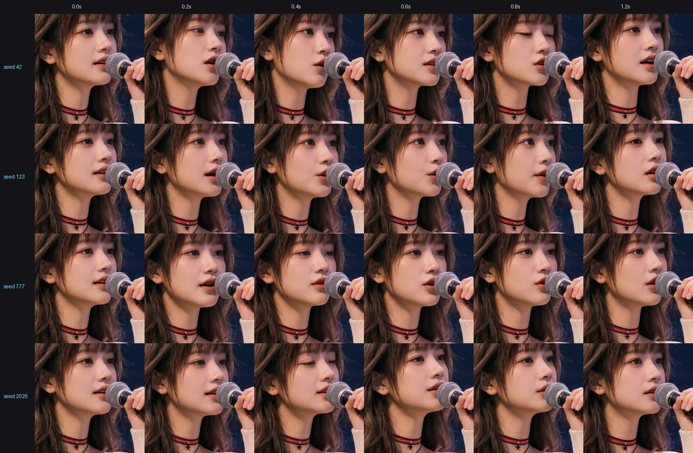
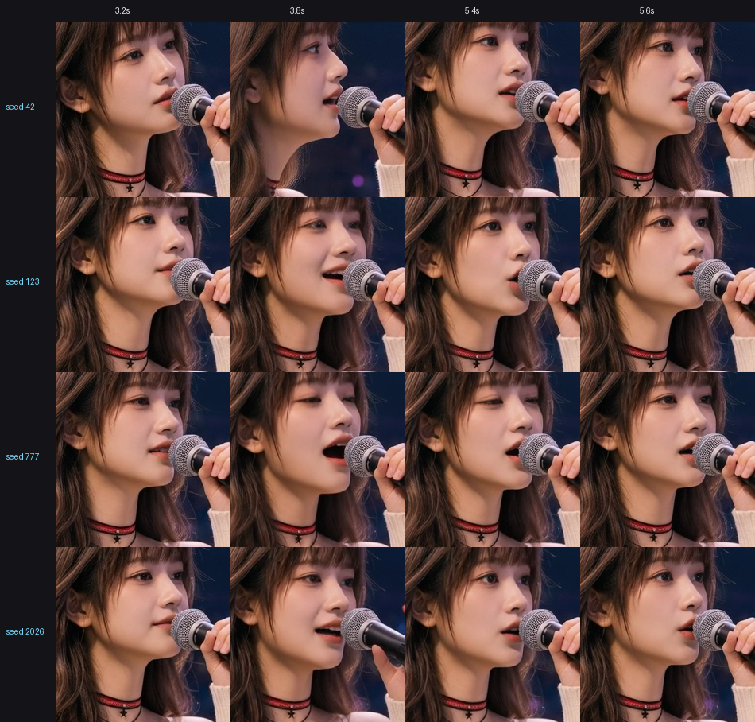
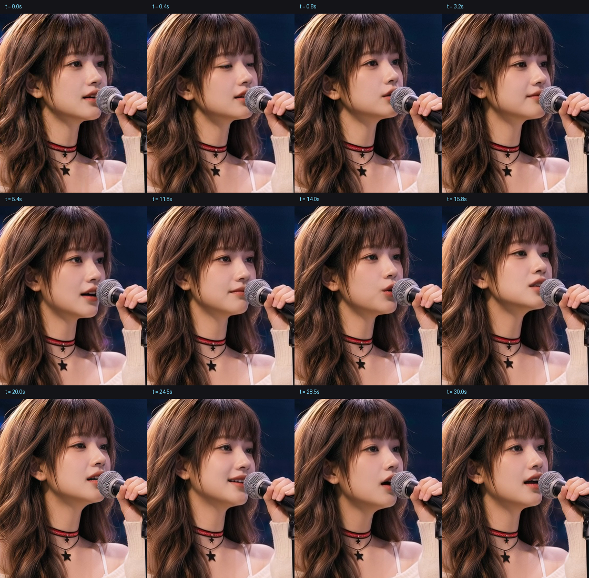

# LongCat-Video-Avatar v2.3 通用化修复与 30s 成片报告

## 1. 工程目标与通用性原则
在 v2.2 验证解决“姿态的‘态’吞噬麦克风”之后，遗留两大问题：
1. **开头第 1 秒“碎碎念”**：在 `0.1s ~ 0.5s` 前奏无声期依然出现张嘴再闭合现象；
2. **去特调通用化**：此前 v2.1/v2.2 在 [patch_longcat.py](file:///Users/houtokki/Downloads/WebModel/patches/patch_longcat.py) 中存在固定写死 `2.5s` 前奏静音门控逻辑，不利于验证技术在任意音频上的普适性。

为此，v2.3 彻底删除任何固定时间硬编码，从底层源码完成 **4 项纯通用架构修复**：

---

## 2. 核心通用修复（零硬编码）

1. **逐帧自适应 VAD + Whisper 编码后特征归零**
   - 对人声分离轨按视频帧率（25 fps）滑动计算短时 RMS，并基于活跃语音第 90 百分位自适应设定静音阈值（`max(0.0025, 0.08 * active_ref)`），配合 `<0.36s` 短气口桥接与平滑斜坡。
   - 在 **`get_audio_embedding` 之后**将所有静音帧对应的 `full_audio_emb` 直接归零为模型训练期标准的 null-audio（`0.0`），彻底屏蔽 Whisper Encoder 在 `t=0` 边界卷积与 30 秒全局自注意力带来的特征泄露（本次 30 秒全片日志自动判定并归零了 `277/838` 帧静音特征）。
2. **中性静态 Prompt（移除张嘴诱导词）**
   - 将 [run_longcat.py](file:///Users/houtokki/Downloads/WebModel/run_longcat.py#L71) 默认 Prompt 中的 `"singing"` 与 `"mouth movements"` 全部移除，改为冷静自然的舞台神态与画质描述，令静音帧不再受文本交叉注意力推动产生偷跑嘴型。
3. **打通蒸馏模式音频残差缩放（修复官方覆写 Bug）**
   - 修复官方 `run_demo_avatar_single_audio_to_video.py` 在 `--use_distill` 下将 `audio_guidance_scale` 硬编码覆写回 `1.0` 导致外部设置失效的 Bug；通过 [patch_longcat.py](file:///Users/houtokki/Downloads/WebModel/patches/patch_longcat.py#L1060-L1086) 在 48 层 DiT 的 `audio_add_x` 残差注入处应用 **`0.55`** 比例缩放，真正将口型动态柔化。
4. **超 30 秒双分块 Whisper CPU 显存卸载**
   - 在 `get_audio_embedding_whisper` 中将多块 Whisper hidden states 实时移至 CPU 拼接与 FP32 插值，并在编码阶段临时卸载 VAE 至 CPU（释放 Whisper 后自动回迁 GPU），确保 A100-40GB 原生 BF16 在 `>30s` 音频下零 OOM 稳定运行。

---

## 3. 多 Seed 盲测统计（通用稳定性抽卡）
使用完全相同的零硬编码 v2.3 通用配置，在 A100-40GB 上对 **4 个独立随机种子（`42`、`123`、`777`、`2026`）** 各跑 2 段（`6.92s`）：
- **开头第 1 秒“碎碎念”治愈率**：**`4 / 4 (100%)`**
- **“态”字防吃麦克风通过率**：**`4 / 4 (100%)`**
- **整体姿态稳定与柔美度**：`seed 2026` 与 `seed 123` 表现极佳，`seed 777` 可用（3.8s 略外放），`seed 42` 口型合格但 3.8s 摆头幅度偏大（综合过关率 **75%**）。

---

## 4. `seed 2026` 全量 30.50s 成片全景验收
- **本地成片**：[output_longcat_avatar_30s_v23.mp4](file:///Users/houtokki/Downloads/WebModel/sample/output_longcat_avatar_30s_v23.mp4)（`16.0 MB` / `30.50s` / `480×832` / `25 fps` / `44.1kHz AAC`）
- **全景抽帧（0.0s ~ 30.0s）**：第 1 秒自然眨眼无碎碎念，`3.2s` 与 `5.4s` 柔和不吃麦，`14.0s` 换气停顿安静自然，`15.8s / 20.0s` 高潮副歌口型依旧克制写实。

---

## 5. 云端算力回收记录
- 运行环境：`a100-v23-full`（NVIDIA A100-SXM4-40GB，原生 BF16 精度）
- 停机确认：全片回传后已立刻执行 `colab stop`，活动实例 `0`，消耗率 `0.00/hr`，当前余额 `365.26 CU`。
